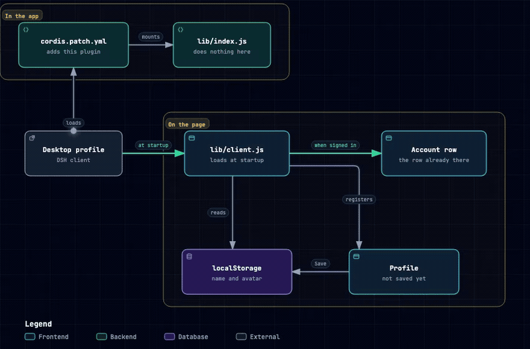
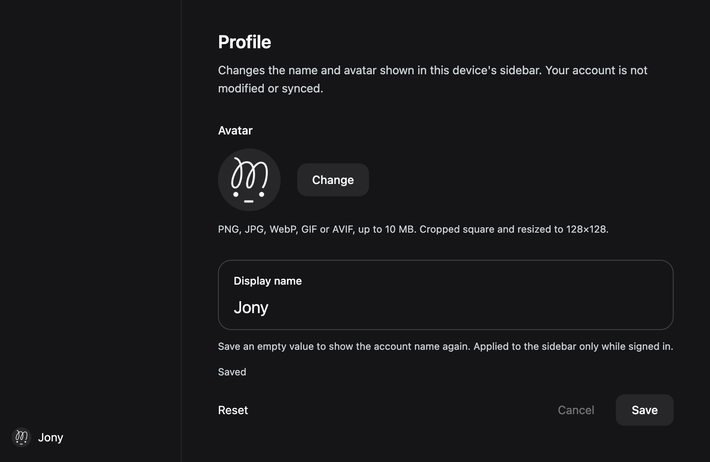

# dsh-plugin-custom-profile

[中文说明](README.zh.md)

Your own name and avatar, on the account row at the bottom left. Only what this machine shows changes. The account is not edited, and nothing is uploaded.

> Package: `dsh-plugin-custom-profile` · Plugin id: `plugin-custom-profile`

Change it at **Settings → Profile**.



## Install

Four ways in. None of them needs a build step. Pick one.

**1. From npm.** The package is published as `dsh-plugin-custom-profile`. In a terminal:

```sh
dsh plugin --profile desktop add dsh-plugin-custom-profile
```

The app's **Settings → Plugins → Install** search lists npm packages once the market index has picked them up. Installing by package name works now.

**2. From GitHub.** No npm involved:

```sh
dsh plugin --profile desktop add github:JonyFang/dsh-plugin-custom-profile
```

**3. From a local checkout.** Clone this repository, then open **Settings → Plugins → Install → Local directory** in the app and select the directory. Or quit the app and run:

```sh
dsh plugin --profile desktop add /absolute/path/to/dsh-plugin-custom-profile
```

**4. By hand.** Symlink this directory into the profile's `node_modules`, then append this to the profile's `cordis.patch.yml`:

```yaml
- insert:
    - id: plugin-custom-profile
      name: dsh-plugin-custom-profile
```

`desktop` is the profile name, so change it for another profile. Restart the app if **Profile** does not appear.

## Use



Set a name and an avatar, then **Save**. An empty name keeps the account name. **Reset**, then **Save**, puts the account name and avatar back. **Cancel** drops unsaved edits.

PNG, JPG, WebP, GIF, or AVIF, up to 10 MB. Cropped to a square and stored as 128×128 WebP, or PNG if that fails. A GIF stays a single frame. Names are at most 32 characters.

## Also

- Signed out, the row is left alone. A collapsed sidebar gets the avatar only.
- The custom row follows this device, not the account. Clearing site data or changing devices removes it.
- Do not run another plugin that paints the same row. This one will not import that plugin's saved values.
- Written against client `0.2.2-rc.1`. If the account-row markup changes, the plugin stops painting instead of breaking the page.

## Development

Node `^22.19.0 || >=24.0.0`. `npm test` runs 57 tests. `lib/index.js` does nothing. `lib/client.js` is the browser bundle. A daily GitHub Action watches the [Harness page](https://www.deepseek.com/en/harness/). A newer client opens an issue for the `dsh-compat` agent.

## License

MIT
