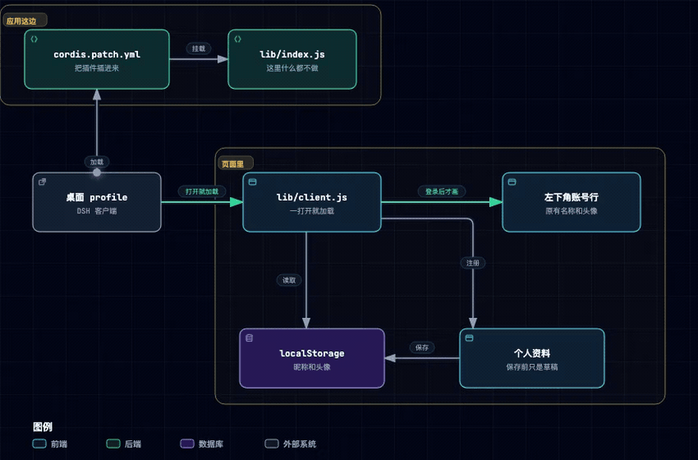
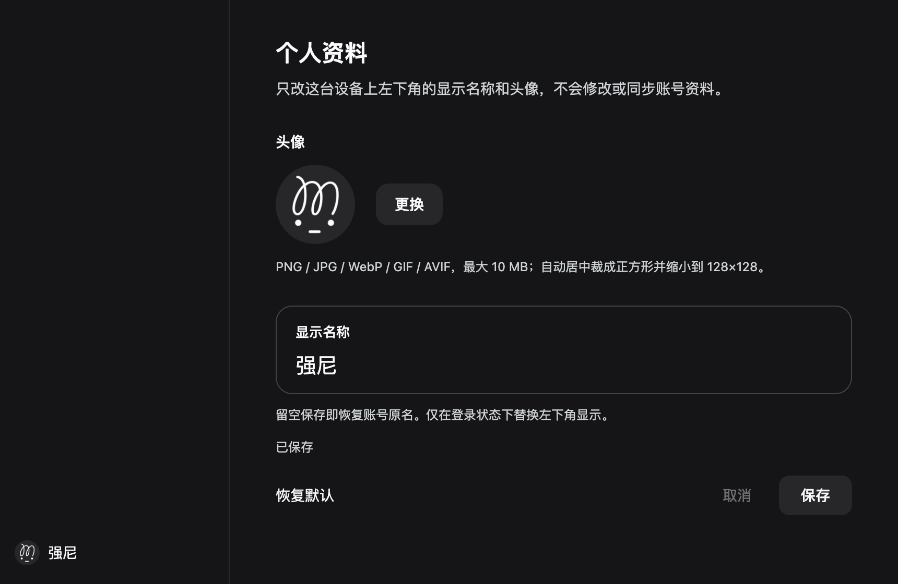

# dsh-plugin-custom-profile

[English](README.md)

左下角换成你自己的昵称和头像。只改这台电脑上看到的样子，不动账号，也不上传。

> 插件 id 是 `plugin-custom-profile`，包名是 `dsh-plugin-custom-profile`。

在 **设置 → 个人资料** 里改。



## 安装

四种方式，都不用构建，选一种。

**1. 从 npm 安装。** 包已经发布，名字是 `dsh-plugin-custom-profile`。命令行直接装：

```sh
dsh plugin --profile desktop add dsh-plugin-custom-profile
```

应用里的 **设置 → 插件 → 安装** 搜索要等市场索引收录之后才有，按包名直接装现在就能用。

**2. 从 GitHub 安装。** 不经过 npm：

```sh
dsh plugin --profile desktop add github:JonyFang/dsh-plugin-custom-profile
```

**3. 本地仓库。** 先 clone 这个仓库，再在应用里打开 **设置 → 插件 → 安装 → 本地目录**，选中它。或者退出应用后：

```sh
dsh plugin --profile desktop add /绝对路径/dsh-plugin-custom-profile
```

**4. 手动安装。** 把这个目录软链接到 profile 的 `node_modules`，再往它的 `cordis.patch.yml` 追加：

```yaml
- insert:
    - id: plugin-custom-profile
      name: dsh-plugin-custom-profile
```

`desktop` 是 profile 的名字，换 profile 就改成对应的。设置里没有 **个人资料**，就重启一次。

## 怎么用



改好昵称和头像，点 **保存**。昵称留空就是账号原来的名字。点 **恢复默认** 再保存，换回原来的样子。**取消** 丢掉没保存的修改。

图片用 PNG、JPG、WebP、GIF 或 AVIF，最大 10 MB。裁成正方形，存成 128×128 的 WebP，不行就用 PNG。GIF 不会动。昵称最多 32 个字符。

## 另外

- 没登录时不动左下角。侧边栏收起时只换头像。
- 这套显示跟着这台设备，不跟着账号。清掉站点数据，或者换一台电脑，就没了。
- 不要和另一个也在改左下角的插件一起开。这里不会导入它存过的值。
- 对照的客户端是 `0.2.2-rc.1`。账号行的标记变了，插件就不再画，也不会把页面弄坏。

## 开发

Node `^22.19.0 || >=24.0.0`。`npm test`，58 个测试。`lib/index.js` 是空的，浏览器里跑的是 `lib/client.js`。每天有一个 GitHub Action 看[Harness 页面](https://www.deepseek.com/en/harness/)。客户端有新版本，就给 `dsh-compat` agent 开一个 issue。

## License

MIT
